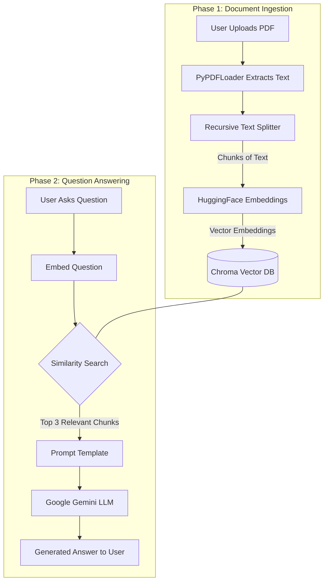

# Project Report: PDF Document Q&A Chatbot (RAG Engine)

## 1. Abstract
The **PDF Document Q&A Chatbot** is an AI-powered web application designed to enable users to interactively query and extract information from PDF documents using Natural Language Processing (NLP). The system utilizes a **Retrieval-Augmented Generation (RAG)** architecture, combining the retrieval capabilities of vector databases with the generative capabilities of Large Language Models (LLMs). By allowing users to upload unstructured PDF files, the system chunks the text, computes semantic embeddings, and retrieves contextually relevant information to answer user queries with high accuracy and precision, drastically reducing the time required for manual document analysis.

---

## 2. Introduction
### 2.1 Problem Statement
In the modern digital era, individuals and organizations deal with massive amounts of unstructured data, often in the form of PDF documents. Manually searching through dense reports, research papers, or manuals to find specific information is a time-consuming and inefficient process. Traditional keyword-based search mechanisms often fail to capture the context or semantic meaning of a user's query.

### 2.2 Objective
The primary objective of this project is to build a conversational interface that allows users to "chat" with their documents. By leveraging a RAG framework, the system aims to:
- Extract text accurately from uploaded PDFs.
- Understand the semantic meaning of user queries.
- Retrieve the most relevant sections of the document.
- Generate concise, context-aware answers using a state-of-the-art LLM.

---

## 3. Technology Stack
The project is built using modern Python frameworks and AI libraries:
- **Programming Language:** Python 3.x
- **Frontend / UI:** [Streamlit](https://streamlit.io/) (for rapid deployment of interactive data apps)
- **AI Orchestration Framework:** [LangChain](https://www.langchain.com/) (provides the underlying framework to stitch together loaders, splitters, vector stores, and LLMs)
- **Document Loader:** `PyPDFLoader` (from LangChain Community)
- **Embeddings:** HuggingFace Sentence Transformers (`all-MiniLM-L6-v2`)
- **Vector Database:** Chroma DB (for fast, in-memory semantic similarity search)
- **Large Language Model (LLM):** Google Gemini (`gemini-3.6-flash`) via `langchain-google-genai`
- **Environment Management:** `python-dotenv` for secure handling of API keys.

---

## 4. System Architecture
The application follows the standard Retrieval-Augmented Generation (RAG) pipeline, which can be divided into two main phases: **Document Ingestion** and **Question Answering**.



---

## 5. Detailed Implementation

### 5.1 Frontend Interface (`app.py`)
The user interface is completely driven by Streamlit.
- **Session State Management:** The app initializes `st.session_state.messages` to maintain the chat history throughout the user's session, simulating a continuous conversation.
- **Sidebar & File Upload:** A sidebar is provided for the user to upload PDF files. Once a file is uploaded, the app reads the file as bytes and passes it to the `RAGEngine` for processing. A spinner provides real-time feedback during processing.
- **Chat Interface:** Uses Streamlit's `st.chat_message` and `st.chat_input` to create a familiar messaging UI. User prompts are appended to the session state, and the assistant's replies are generated dynamically.

### 5.2 RAG Engine (`rag_engine.py`)
The core logic resides in the `RAGEngine` class.

#### 5.2.1 Initialization
Upon instantiation, the class securely loads the `GOOGLE_API_KEY` from the `.env` file. It then initializes the **HuggingFace Embeddings** and the **Google Gemini LLM**. Using a local HuggingFace embedding model (`all-MiniLM-L6-v2`) ensures that generating vectors is fast, cost-effective, and doesn't require an external API for the embedding phase.

#### 5.2.2 Document Processing (`process_pdf`)
1. **Temporary Storage:** Because `PyPDFLoader` requires a file path, the uploaded bytes are temporarily written to the disk using Python's `tempfile` module.
2. **Text Loading:** The document is loaded into memory as a list of LangChain `Document` objects.
3. **Text Chunking:** The `RecursiveCharacterTextSplitter` is employed to break the document down into smaller, digestible chunks.
   - **Chunk Size:** 1000 characters.
   - **Chunk Overlap:** 200 characters. 
   *(Overlap ensures that semantic context isn't lost if a sentence or paragraph is cut in half between two chunks).*
4. **Vector Store Creation:** The text chunks are passed through the HuggingFace embedding model to generate numerical vectors, which are then indexed and stored in a **Chroma** database. If a database already exists in the session, new documents are appended.
5. **Cleanup:** The temporary PDF file is deleted from the disk to prevent storage leaks.

#### 5.2.3 Prompt Engineering and QA Chain
The application defines a strict system prompt to guide the LLM's behavior:
> *"You are an assistant for question-answering tasks. Use the following pieces of retrieved context to answer the question. If you don't know the answer, say that you don't know. Use three sentences maximum and keep the answer concise."*

This ensures the LLM does not hallucinate answers outside the scope of the provided document. A `ChatPromptTemplate` merges this system prompt with the user's question and the retrieved context.

#### 5.2.4 Question Answering (`ask_question`)
When a user submits a question:
1. The **Retriever** queries the Chroma database using semantic similarity to find the top `k=3` most relevant text chunks.
2. The context from these chunks is concatenated into a single string.
3. The prompt is formatted and sent to the **Google Gemini LLM**.
4. The response is parsed to extract the pure text content and returned to the Streamlit frontend.

---

## 6. Setup & Execution
### Prerequisites
- Python 3.8+
- A valid Google Gemini API key.

### Installation
1. Clone the repository and navigate to the project folder.
2. Create a virtual environment: `python -m venv venv`
3. Activate the virtual environment.
4. Install dependencies: `pip install -r requirements.txt`
5. Create a `.env` file in the root directory and add the API key:
   ```env
   GOOGLE_API_KEY="your_api_key_here"
   ```

### Running the Application
Execute the following command in the terminal:
```bash
streamlit run app.py
```
This starts a local web server and opens the application in the default web browser.

---

## 7. Results and Performance
The application successfully fulfills its objective. Key performance highlights include:
- **Speed:** Local embeddings via HuggingFace ensure that the document indexing process is incredibly fast.
- **Accuracy:** The RAG architecture strictly limits the LLM's knowledge base to the provided document, drastically reducing the chance of AI hallucinations.
- **User Experience:** The Streamlit interface is intuitive, responsive, and handles asynchronous tasks (like document processing) gracefully with loading spinners.

---

## 8. Future Enhancements
While the current implementation is highly functional, several improvements can be made for a production-grade application:
1. **Persistent Vector Database:** Transitioning Chroma from an in-memory instance to a persistent directory so that users don't have to re-upload the same document across sessions.
2. **Conversational Memory:** Integrating `ConversationBufferMemory` so the LLM remembers previous questions and context within the same chat session.
3. **Multi-Document Support:** Expanding the UI to allow for batch uploading and querying across an entire library of documents simultaneously.
4. **Enhanced File Support:** Adding loaders for Word documents (`.docx`), Excel spreadsheets (`.xlsx`), and plain text files (`.txt`).

---

## 9. Conclusion
The PDF Document Q&A Chatbot demonstrates the practical power of combining Large Language Models with vector search databases. By building a Retrieval-Augmented Generation pipeline using LangChain, Google Gemini, and Streamlit, the project successfully bridges the gap between unstructured data and actionable insights, proving to be a highly valuable tool for research, study, and professional data analysis.
